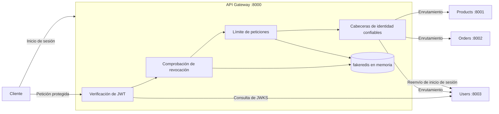
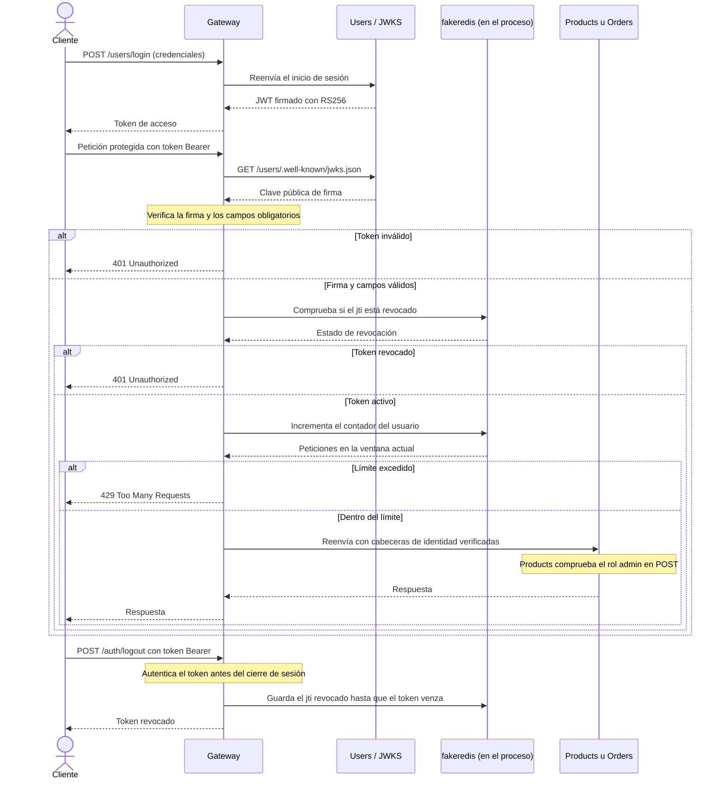

# Proyecto de aprendizaje: API Gateway

Proyecto de aprendizaje que demuestra el uso de un API gateway delante de tres servicios FastAPI. El gateway valida JWT con RS256, comprueba su revocación, limita las peticiones por usuario y propaga la identidad verificada a los servicios.

## Arquitectura



`fakeredis` se ejecuta dentro del proceso del gateway; no es un servidor Redis independiente. El inicio de sesión se reenvía directamente a `users`. Las peticiones protegidas siguen el flujo **AUTH → LIMIT → ROUTE**; el gateway crea cabeceras de identidad para `products` y `orders`.

## Decisiones de diseño

| Decisión | Beneficio y compromiso |
| --- | --- |
| RS256 + JWKS en lugar de HS256 | `users` firma con una clave privada y el gateway verifica con una clave pública, por lo que los verificadores no reciben un secreto de firma. RSA y la distribución de claves agregan complejidad; actualmente el gateway consulta el JWKS en cada petición autenticada. |
| Lista de revocación de `jti` compatible con Redis | Un token revocado puede rechazarse antes de que venza; la entrada usa el tiempo de vida restante del token como TTL. La revocación agrega estado y una consulta por cada petición autenticada. Esta demostración usa `fakeredis` dentro del proceso, por lo que el estado no es persistente ni compartido. |
| Prevención de suplantación de cabeceras | El gateway construye las cabeceras internas de identidad a partir de las afirmaciones verificadas del token en vez de reenviar las que proporciona el cliente. Esto solo protege las peticiones que pasan por el gateway: también hay que restringir y autenticar el acceso directo a los servicios. |

## Comandos rápidos

Después de realizar la configuración inicial, ejecuta estos comandos desde la raíz del proyecto con el entorno virtual activado:

```powershell
python run.py        # Inicia el gateway y los servicios
python -m pytest -v   # Ejecuta las pruebas en otra terminal
```

## Configuración inicial

Desde la raíz del proyecto, en PowerShell:

```powershell
py -m venv venv
.\venv\Scripts\Activate.ps1
python -m pip install -r requirements-dev.txt
python generate_keys.py
```

Genera las claves una sola vez: el script no sobrescribe un par existente. Git ignora el directorio `keys/`. Detén todos los servicios con Ctrl+C. Reinicia el script después de modificar el código.

## Probar la autenticación

1. Abre http://127.0.0.1:8000/docs.
2. Ejecuta `POST /users/login` con `{"username": "demo", "password": "learning-gateway"}`.
3. Copia `access_token`, haz clic en **Authorize** y pega el token.
4. Ejecuta `GET /{service}` con `products`, `orders` o `users`.

Para probar el acceso basado en roles, ejecuta `POST /products` con `{"name": "Monitor", "price": 100}`. La cuenta `demo` tiene el rol `user` y recibe un 403. Inicia sesión como `admin` con la contraseña `admin-gateway`, reemplaza el token mediante **Authorize** y repite la petición para recibir un 201. Ambas son credenciales de demostración locales.

Los tokens vencen después de 15 minutos. El JWKS público está disponible en http://127.0.0.1:8003/users/.well-known/jwks.json. El gateway lo consulta en cada petición autenticada; si `users` no está disponible, responde con 503. El inicio de sesión es una ruta pública; las demás rutas del gateway requieren un token.

### Cierre de sesión y límite de peticiones

Con un token autorizado en `/docs`, ejecuta `POST /auth/logout`. Volver a usar ese mismo token devuelve 401; los demás tokens no se ven afectados. El `jti` del token revocado se guarda hasta que este vence.

El gateway permite 30 peticiones enrutadas por usuario durante cada minuto fijo del reloj; las siguientes reciben 429 y una cabecera `Retry-After` con los segundos restantes hasta la siguiente ventana. Varios tokens del mismo usuario comparten un contador. El inicio y el cierre de sesión no cuentan para este límite. Como la ventana es fija y no móvil, puede haber una ráfaga de peticiones alrededor del cambio de ventana. Una petición rechazada no llega al servicio de destino, aunque la autenticación todavía consulta el JWKS a `users`.

Los contadores y tokens revocados se guardan en `fakeredis` dentro del proceso del gateway, sin un servidor Redis externo. **Al reiniciar el gateway se borran**, por lo que un token revocado anteriormente podría volver a funcionar hasta que venza. Varios procesos del gateway tampoco comparten este estado. Cuando se requieran persistencia y revocación compartida entre instancias, utiliza un servidor Redis real compartido y configurado adecuadamente.

## Cómo funciona

`users` comprueba las credenciales de demostración y firma con su clave RSA privada un JWT que contiene `sub`, `role`, `jti` y `exp`. La cabecera del JWT identifica la clave de firma mediante `kid`. El gateway selecciona la clave pública correspondiente del JWKS y verifica la firma y los campos obligatorios antes de reenviar una petición. El gateway nunca necesita la clave privada. La firma protege la integridad; no cifra las afirmaciones del JWT.



Un token ausente o mal formado se rechaza antes de consultar el JWKS. Durante la autenticación del cierre de sesión también se consulta el JWKS y se comprueba la revocación.

Para `products` y `orders`, el gateway construye `X-User-Id` y `X-User-Role` a partir de las afirmaciones verificadas en lugar de reenviar las cabeceras proporcionadas por el cliente. `products` requiere el rol `admin` para `POST /products`; los productos se guardan en memoria y se reinician al reiniciar el servicio.

Las cuentas y contraseñas son solo para aprendizaje local. Se puede acceder directamente a los servicios en localhost, por lo que un cliente puede evitar el gateway y falsificar la cabecera interna del rol. Un despliegue de producción necesita una red privada y comunicación autenticada entre servicios, además de una gestión de identidad adecuada, almacenamiento seguro de claves, TLS y una estrategia de rotación de claves.

## Ejecutar las pruebas

```powershell
python -m pip install -r requirements-dev.txt
python -m pytest -v
```

Las pruebas generan sus propios pares de claves temporales y utilizan clientes dentro del proceso y un transporte HTTP simulado; no requieren servicios en ejecución ni archivos de claves locales. Cubren autenticación, propagación de identidad, autorización, suplantación de cabeceras, cierre de sesión, límite de peticiones y fallos del JWKS. La cuenta de demostración tiene el rol `user`; las pruebas de seguridad también comprueban un token firmado con el rol `customer`, que tampoco tiene permiso para crear productos.
